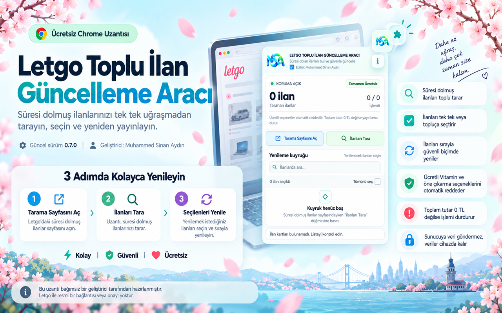

# Letgo Toplu İlan Güncelleme Aracı
### Letgo Bulk Listing Renewal Tool

**Süresi dolmuş ilanları tara, seç ve sırayla yenile.**  
**Scan, select and renew expired listings in sequence.**

`v0.7.0` · `Manifest V3` · `JavaScript` · `Local storage`

[Türkçe](#turkce) · [English](#english) · [Kaynak / Source](extension/) · [İnceleme / Review](docs/REVIEW.md)

<a id="turkce"></a>
## Türkçe

### Proje hakkında
Letgo Toplu İlan Güncelleme Aracı, kendi hesabınızdaki süresi dolmuş ilanları tarayıp seçtiğiniz ilanları mevcut bilgileriyle sırayla yeniden yayınlamanıza yardımcı olan bağımsız bir Chrome uzantısıdır. Tekrarlanan sayfa adımlarını azaltırken ilan kimliğini, form durumunu ve yayınlama öncesi toplam tutarı denetler.

**Geliştirici:** [Muhammed Sinan Aydın](https://www.linkedin.com/in/sinanback/) · [GitHub](https://github.com/sinanback)

### Öne çıkan özellikler
- Süresi Dolmuş listesini sayfalar boyunca tarama; ilan başlığı ve numarasıyla arama.
- Tek tek seçim, görünen ilanları toplu seçim ve uygun ilanlar için **Tümünü Yenile**.
- Tek işlem sekmesi ve sıralı kuyruk; ilerleme ve ilan bazında sonuç raporu.
- Taranan başlık, fiyat ve kapak görseliyle eşleşme kontrolü; form değişikliklerini SHA-256 parmak iziyle denetleme.
- Tanınan varsayılan ücretli Vitamin paketini kaldırma; toplam tutar sıfır olarak doğrulanmadan son yayınlama adımına geçmeme.
- Kaldırılan veya listeden çıkan ilanları atlama; beklenmeyen ekranlarda işlemi durdurma.
- Kullanıcının durdurma isteğini işleme alma; kapanan sekmede veya yeniden başlayan tarayıcıda otomatik devam etmeme.

### Kurulum ve kullanım
1. Bu depoda **Code → Download ZIP** ile kaynakları indirin ve arşivi çıkarın.
2. Chrome'da `chrome://extensions` adresini açıp **Geliştirici modu** seçeneğini etkinleştirin.
3. **Paketlenmemiş öğe yükle** düğmesinden bu deponun **`extension/` klasörünü** seçin. Depo kökünü seçmeyin.
4. Letgo hesabınıza giriş yapın. Uzantıdan **Tarama Sayfasını Aç** ile `https://www.letgo.com/ilanlarim?status=outdated` adresine gidin. Bu düğme mevcut sekmenin adresini değiştirir.
5. Gerekirse Letgo sekmesini yenileyin; ilk sayfada **İlanları Tara** düğmesine basın ve taramanın bitmesini bekleyin.
6. İlanları seçip **Seçilenleri Yenile** veya **Tümünü Yenile** düğmesine basın. **Tümünü Yenile**, arama filtresinden bağımsız olarak taranan tüm uygun ilanları kapsar.
7. İşlem sekmesini açık tutun, işlem sırasında sayfada gezinmeyin ve sonuçları kontrol edin. Gerektiğinde **İşlemi Durdur** kullanın.

### Güvenlik ve sınırlar
Kod, tanınan akışta ücretli seçenek seçiliyse veya toplam `0 TL` değilse yayınlamayı durduracak kontroller içerir. Bunlar Letgo'nun değişebilen sayfa yapısına bağlıdır; ücret oluşmayacağına veya her ilanın yenileneceğine dair garanti değildir.

- CAPTCHA, erişim sınırı, oturum/kota engeli, yeni sözleşme veya tanınmayan pencere algılandığında kullanıcı kontrolü gerekir; bunları aşmaya çalışmaz.
- Teslimat adımı yalnızca **elden teslim açık, güvenli ödeme kapalı** düzeninde doğrulanır. Diğer düzenlerde ayarları değiştirmek yerine durur.
- Son yayınlama isteğinin sonucu belirsizse otomatik tekrar göndermez; etkin ilanları elle kontrol edin.
- Başarılı ilanlar mevcut tarama için kilitlenir; yeniden tarama başarı kilitlerini temizler. Belirsiz sonuç kilitleri korunur.
- Durdurma, daha önce gönderilmiş yayınlama isteğini geri almaz.
- Yalnızca kendi ilanlarınızda ve platformun geçerli kullanım kurallarına uygun kullanın. Bu yayın hazırlığında canlı ilan yenilemesi yapılmadı.

### Gizlilik ve izinler
Manifest yalnızca **`storage`** API iznini bildirir. İçerik betikleri yalnızca **`https://www.letgo.com/*`** üzerinde çalışır; bu, Letgo sayfalarını okuma ve kullanıcı tarafından başlatılan işlemlerle etkileşme erişimidir.

İlan numarası, başlık, fiyat, görsel adresi, ilan bağlantısı, kuyruk, ilerleme, sonuçlar, zaman bilgileri ve güvenlik kilitleri `chrome.storage.local` içinde saklanır. Form değerleri ve telefon düğmesi metni değişiklik kontrolü için geçici olarak okunur; ham form/telefon değerleri yerine özet parmak izleri saklanır. Bunlar anonim veri garantisi değildir.

İncelenen kodda geliştirici sunucusu, analiz sistemi, uzaktan kod yükleme veya ayrı veri gönderim çağrısı bulunmuyor. Yenileme yine açık Letgo oturumunuzun normal ağ işlemlerini gerçekleştirir. Geliştirici bağlantısına tıklamak LinkedIn'i açar. Yerel durum otomatik süre sonunda silinmez; kaldırma işlemi uzantının yerel verilerini temizler.

### Teknoloji ve yapı
Derleme gerektirmeyen JavaScript, HTML ve CSS; Chrome Manifest V3 servis çalışanı; Chrome mesajlaşma ve yerel depolama API'leri; Web Crypto SHA-256.

```text
assets/cover.png       Tanıtım kapağı
extension/
  manifest.json       Sürüm, izinler ve kapsam
  background.js       Tek çalışma/sekme kilidi ve durum yönetimi
  core.js             Tutar, URL ve adım yardımcıları
  content.js          Sayfa kontrolleri ve yenileme akışı
  popup.html/css/js    Kontrol paneli
  icons/              Uzantı simgeleri ve geliştirici logosu
docs/REVIEW.md        Yayın öncesi inceleme ve doğrulama
```

### Sürüm, görseller ve lisans durumu
Manifest sürümü **0.7.0**. Yenileme kodu yüklenen arşivden korunmuştur. GitHub kaynak kopyasında Gilroy font dosyaları dağıtılmaz; CSS sistemde bulunan Arial/sans-serif kullanır. Bu nedenle görünüm kapaktan ve orijinal paketten küçük ölçüde farklı olabilir. Kapak tanıtım görselidir; canlı başarı kaydı değildir.

Bu depo için ayrıca açık kaynak lisansı verilmemiştir; public erişim sınırsız yeniden dağıtım izni anlamına gelmez. Üçüncü taraf marka ve görsellerinin hakları sahiplerine aittir. Letgo adı yalnızca uyumlu platformu tanımlar. **Bu proje Letgo tarafından geliştirilmemiş, desteklenmemiş veya onaylanmamıştır.** Mağaza uygunluğu sertifikası verilmez.

---

<a id="english"></a>
## English

### About
Letgo Bulk Listing Renewal Tool is an independent Chrome extension that scans expired listings in your own account and republishes selected listings sequentially using their existing information. It reduces repetitive navigation while checking listing identity, form consistency and the total before publication.

**Developer:** [Muhammed Sinan Aydın](https://www.linkedin.com/in/sinanback/) · [GitHub](https://github.com/sinanback)

### Features
- Scan multiple pages of expired listings; search by listing title or ID.
- Select individual or visible listings, or renew all eligible scanned listings.
- A sequential queue owned by one tab, with progress and per-listing outcomes.
- Compare title, price and cover image with the scan; detect form changes using SHA-256 fingerprints.
- Deselect recognized default paid Vitamin bundles and require a verified zero total before the final publishing action.
- Skip removed or missing listings; stop on unexpected screens.
- Stop controls, with no automatic continuation after the owner tab closes or the browser restarts.

### Install and use
1. Choose **Code → Download ZIP** and extract the repository.
2. Open `chrome://extensions` in Chrome and enable **Developer mode**.
3. Click **Load unpacked** and select the **`extension/` directory**, not the repository root.
4. Sign in to Letgo. Click **Tarama Sayfasını Aç** (Open scan page) to open `https://www.letgo.com/ilanlarim?status=outdated`. This navigates the current tab.
5. Refresh the Letgo tab if needed. From the first page, click **İlanları Tara** (Scan listings) and wait for completion.
6. Select listings and click **Seçilenleri Yenile** (Renew selected), or **Tümünü Yenile** (Renew all). Renew all includes every eligible scanned listing, regardless of the search filter.
7. Keep the working tab open, avoid navigating during a run and review the results. Use **İşlemi Durdur** (Stop) when needed.

The extension interface and recognized Letgo page labels are Turkish; this README provides bilingual documentation.

### Safety and limitations
The code contains checks intended to stop publication if a paid option remains selected or the total is not `0 TL`. These checks depend on Letgo's page structure and do not guarantee zero charges or successful renewal after platform changes.

- Detected CAPTCHAs, access limits, session/quota issues, new agreements and unknown dialogs require user attention; the extension does not bypass them.
- The delivery step supports only the verified layout with hand delivery enabled and secure payment disabled. Other configurations stop without changing those settings.
- An uncertain final publishing result is not automatically retried; check active listings manually.
- Successful listings are locked within the current scan. A new scan clears success locks while retaining uncertain-result locks.
- Stopping cannot undo a publishing request already submitted.
- Use only for your own listings and in accordance with the platform's current rules. No live listings were renewed during this publication review.

### Privacy and permissions
The manifest declares only the **`storage`** API permission. Content scripts match **`https://www.letgo.com/*`**, allowing them to read and interact with Letgo pages for user-initiated workflows.

Listing IDs, titles, prices, image URLs, listing URLs, queue state, progress, results, timestamps and safety locks are stored in `chrome.storage.local`. Form values and phone-button text are read temporarily to detect changes; fingerprints are stored instead of raw form/phone values. Fingerprints are not a guarantee of anonymization.

The inspected source contains no developer backend, analytics, remote code loading or separate data-upload calls. Renewal still performs normal Letgo network operations through your signed-in session. Clicking the developer link opens LinkedIn. Local state has no automatic expiry; uninstalling the extension clears its local storage.

### Technology
Plain JavaScript, HTML and CSS, with no build step. Chrome Manifest V3 service worker, extension messaging, local storage and Web Crypto SHA-256. See the directory map above and the [publication review](docs/REVIEW.md).

### Version, assets and licensing
The manifest version is **0.7.0**. Renewal logic is preserved from the supplied archive. This GitHub source edition omits Gilroy font binaries and uses Arial/sans-serif instead, so its typography may differ slightly from the original package and promotional cover. The cover is a promotional illustration, not evidence of a live successful run.

No additional open-source license is granted for this repository. Public access does not imply unrestricted redistribution rights. Third-party brands and assets remain subject to their owners' rights. Letgo is named only to identify the compatible platform. **This project is not developed, endorsed or supported by Letgo.** This review does not certify Chrome Web Store compliance.